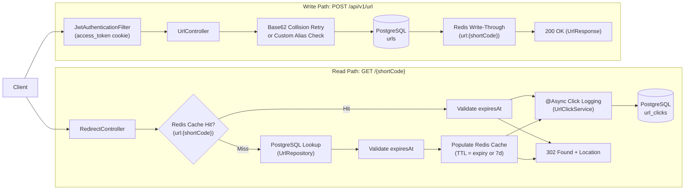

# SwiftRoute

SwiftRoute is a URL shortener backend built with **Java 25**, **Spring Boot 4.1.2**, **PostgreSQL**, and **Redis**. It pairs cache-aside/write-through Redis redirects and `@Async` click analytics with stateless dual-token JWT `HttpOnly` cookie authentication and Base62 short-code generation.

---

## System Architecture



---

## Key Engineering Highlights

* **Cache-Aside & Write-Through Redis Caching (`UrlCacheService`):** Newly created links are written through to Redis under `url:{shortCode}` with a TTL matching `expiresAt` (defaulting to `7` days when no expiration is set). On `GET /{shortCode}`, cache hits validate expiration in memory and use `urlRepository.getReferenceById(...)` to avoid a `SELECT` on `urls`, while Redis exceptions are caught so reads gracefully fall back to PostgreSQL.
* **Non-Blocking Click Analytics (`UrlClickService`):** Redirect tracking runs asynchronously via `@EnableAsync` / `@Async`, extracting client IP (`X-Forwarded-For` or `remoteAddr`), `User-Agent`, and `Referer` into `url_clicks` without adding write latency to the `302 Found` redirect critical path.
* **Collision-Safe Base62 Short Codes (`Base62`, `UrlService`):** Generates 7-character `SecureRandom` Base62 codes (`[0-9a-zA-Z]`) with collision checking against `urls.short_code` (up to 5 retry checks) backed by a database `UNIQUE` constraint. Supports validated custom aliases (`^[a-zA-Z0-9_-]{3,12}$`) returning `409 Conflict` on duplicate.
* **Stateless Dual-Token JWT Cookie Auth (`JwtService`, `CookieService`, `JwtAuthenticationFilter`):** Authenticates requests via `OncePerRequestFilter` reading the `access_token` `HttpOnly` cookie (`SameSite=Strict`). Access tokens expire in `15` minutes (`900000 ms`, `path=/`) and refresh tokens in `7` days (`604800000 ms`, `path=/api/v1/auth`), with `secure` controlled per Spring profile (`false` in `dev`, `true` in `prod`).
* **Cloud PostgreSQL Pool Tuning (`application.yaml`):** Configures HikariCP for cloud-hosted PostgreSQL (`maximum-pool-size: 10`, `minimum-idle: 2`, `idle-timeout: 30000`, `keepalive-time: 30000`, `max-lifetime: 600000`, `connection-timeout: 20000`) with `spring.jpa.open-in-view: false` to prevent holding DB connections across HTTP rendering.

---

## Tech Stack

| Layer | Technology & Version |
| :--- | :--- |
| **Language** | Java `25` |
| **Framework** | Spring Boot `4.1.2` (WebMVC, Security, Data JPA, Data Redis, Validation, Actuator) |
| **Authentication** | `io.jsonwebtoken:jjwt` `0.12.6` (HMAC-SHA JWTs in `HttpOnly` cookies) |
| **Database & Pool** | PostgreSQL (`org.postgresql:postgresql`), HikariCP |
| **Cache** | Redis (`RedisTemplate<String, Object>` with JSON serialization) |
| **Mapping & Boilerplate** | MapStruct `1.6.3`, Lombok |
| **API Docs** | `springdoc-openapi-starter-webmvc-ui` `3.2.0` (Swagger UI / OpenAPI 3) |
| **Build & Test** | Gradle `9.8.2`, JUnit 5, Mockito, Spring MockMvc (`@WebMvcTest`) |
| **Load Testing** | Grafana k6 |

---

## Performance Benchmarks (Grafana k6)

All benchmarks were executed using **Grafana k6** against the compiled Spring Boot JAR (`-Xmx512m`) connected to cloud-hosted **Supabase PostgreSQL** and **Upstash Redis**.

### 1. Read Redirect A/B Test (`GET /{shortCode}`)

* **Profile:** 25 Virtual Users (VUs), 70-second sustained load (`15s` ramp-up, `45s` steady, `10s` ramp-down), ~1,980 seeded URLs (`benchmarks/RedirectUrlBenchmark.js`).

| Metric | PostgreSQL Only (No Redis) | With Redis Cache | Improvement |
| :--- | :--- | :--- | :--- |
| **Total Redirects Served** | 2,094 | 7,564 | **3.61x volume** |
| **Throughput (`http_reqs`)** | 29.91 req/s | 107.90 req/s | **3.61x higher RPS** |
| **Median Latency (`med`)** | 406.26 ms | 42.66 ms | **89.5% faster (9.5x)** |
| **90th Percentile (`p90`)** | 540.86 ms | 44.48 ms | **91.8% faster (12.2x)** |
| **95th Percentile (`p95`)** | 760.19 ms | 50.65 ms | **93.3% faster (15.0x)** |
| **Max Latency (`max`)** | 1.86 s | 371.70 ms | **80.0% lower tail spike** |
| **Success Rate** | 100.00% | 99.93% | — |

**Architectural Takeaway:** Without Redis, 25 concurrent VUs queued on the 10-connection HikariCP pool over TLS, pushing `p(95)` latency to `760 ms`. Enabling Redis cache-aside reads alongside `@Async` click logging eliminated database read contention on the redirect path, cutting `p(95)` latency to `50.65 ms` and scaling throughput by **3.6x**.

### 2. Concurrent Write Contention (`POST /api/v1/url`)

* **Profile:** 10 VUs executing 500 concurrent URL creation requests (`benchmarks/CreateUrlBenchmark.js`).
* **Result:** **100.00% success rate** (`500/500`), **0 Base62 collisions**, `9.20 req/s` throughput, `856.17 ms` median / `1.70 s` p95 latency.

---

## Database Schema

Managed via Spring Data JPA (`hibernate.ddl-auto: update`) with JPA auditing (`created_at`, `updated_at` on `BaseEntity`):

* **`users`** (`User`)
  * Columns: `id` (PK), `name` (`VARCHAR(100)`), `email` (`VARCHAR(150)`, `UNIQUE`), `password_hash` (`VARCHAR(255)`), `created_at`, `updated_at`
  * Indexes: `idx_users_email` on `email`
* **`urls`** (`Url`) — `ManyToOne` -> `users.id` (`fk_urls_user_id`)
  * Columns: `id` (PK), `original_url` (`TEXT`), `short_code` (`VARCHAR(12)`, `UNIQUE`), `expires_at` (`TIMESTAMP`, nullable), `user_id` (`BIGINT`, `NOT NULL`), `created_at`, `updated_at`
  * Indexes: `idx_urls_short_code` on `short_code`, `idx_urls_user_id` on `user_id`
* **`url_clicks`** (`UrlClick`) — `ManyToOne` -> `urls.id` (`fk_url_clicks_url_id`)
  * Columns: `id` (PK), `url_id` (`BIGINT`, `NOT NULL`), `clicked_at` (`TIMESTAMP`, `@CreatedDate`), `referrer` (`VARCHAR(512)`), `user_agent` (`VARCHAR(512)`), `ip_address` (`VARCHAR(45)`)
  * Indexes: `idx_url_clicks_url_id` on `url_id`, `idx_url_clicks_clicked_at` on `clicked_at`

---

## API Reference

Interactive OpenAPI documentation is available at `/swagger-ui.html` (spec at `/v3/api-docs`).

| Method | Path | Auth | Description |
| :--- | :--- | :--- | :--- |
| `POST` | `/api/v1/auth/register` | Public | Registers a new user (`201 Created`). |
| `POST` | `/api/v1/auth/login` | Public | Validates credentials and sets `access_token` & `refresh_token` `HttpOnly` cookies (`200 OK`). |
| `POST` | `/api/v1/auth/refresh` | `refresh_token` cookie | Validates refresh cookie and issues a new `access_token` cookie (`200 OK`). |
| `POST` | `/api/v1/auth/logout` | Public | Clears `access_token` and `refresh_token` cookies (`200 OK`). |
| `GET` | `/{shortCode}` | Public | Resolves URL from Redis/PostgreSQL, logs click asynchronously, returns `302 Found` (`404`/`410` if missing/expired). |
| `POST` | `/api/v1/url` | Authenticated (`access_token`) | Creates a Base62 short URL or custom alias with optional `expiresAt` (`200 OK`). |
| `GET` | `/api/v1/url/my-urls` | Authenticated (`access_token`) | Returns all short URLs owned by the authenticated user (`200 OK`). |
| `GET` | `/api/v1/url/{shortCode}/analytics` | Authenticated (Owner) | Returns total clicks and top 10 most recent clicks ordered by `clickedAt DESC` (`200 OK`). |
| `DELETE` | `/api/v1/url/{shortCode}` | Authenticated (Owner) | Deletes URL, associated `url_clicks` rows, and evicts `url:{shortCode}` from Redis (`204 No Content`). |

### Sample Payloads

**Create Short URL — `POST /api/v1/url`**

Request:

```json
{
  "originalUrl": "https://example.com/engineering/distributed-caching",
  "customAlias": "cache-guide",
  "expiresAt": "2027-01-01T00:00:00Z"
}
```

Response (`200 OK`):

```json
{
  "shortCode": "cache-guide",
  "originalUrl": "https://example.com/engineering/distributed-caching",
  "expiresAt": "2027-01-01T00:00:00Z",
  "createdAt": "2026-11-26T17:42:10Z"
}
```

**URL Analytics — `GET /api/v1/url/{shortCode}/analytics`**

Response (`200 OK`):

```json
{
  "shortCode": "cache-guide",
  "originalUrl": "https://example.com/engineering/distributed-caching",
  "totalClicks": 142,
  "createdAt": "2026-11-26T17:42:10Z",
  "expiresAt": "2027-01-01T00:00:00Z",
  "recentClicks": [
    {
      "clickedAt": "2026-11-26T17:45:03Z",
      "referrer": "https://github.com/",
      "userAgent": "Mozilla/5.0",
      "ipAddress": "203.0.113.5"
    }
  ]
}
```

---

## Testing

The `src/test/java/com/swiftroute/` suite covers unit, security filter, and controller slice tests:

* **Controllers (`@WebMvcTest`):** `AuthControllerTest`, `UrlControllerTest`, `RedirectControllerTest`
* **Services (JUnit 5 + Mockito):** `AuthServiceTest`, `UrlServiceTest`, `UrlCacheServiceTest`, `UrlClickServiceTest`, `JwtServiceTest`, `CookieServiceTest`
* **Filter & Utilities:** `JwtAuthenticationFilterTest`, `Base62Test`

Run the test suite:

```bash
# Linux / macOS
./gradlew test

# Windows
.\gradlew.bat test
```

Run the Grafana k6 benchmarks against a running local instance (`http://localhost:8080`):

```bash
# Read redirect benchmark (requires benchmarks/shortcodes.json)
# Export benchmarks/shortcodes.json via: SELECT json_agg(short_code) FROM urls; (expects [{"json_agg": [...]}])
k6 run benchmarks/RedirectUrlBenchmark.js

# Concurrent write contention benchmark (logs in as test@email.com / password123 in setup())
k6 run benchmarks/CreateUrlBenchmark.js
```

---

## Local Setup & Run

### Prerequisites

* **Java 25** JDK
* **PostgreSQL** instance (local or cloud, e.g., Supabase)
* **Redis** instance (local or cloud, e.g., Upstash)
* **Grafana k6** (optional, for running load tests in `benchmarks/`)

### Environment Variables

Configure the environment variables referenced in `src/main/resources/application.yaml`:

```bash
export SUPABASE_DB_URI="jdbc:postgresql://localhost:5432/swiftroute?user=postgres&password=your_db_password"
export REDIS_DB_URI="redis://localhost:6379"
# Base64-encoded 256-bit (32+ byte) secret key for HMAC-SHA JWT signing
export JWT_SECRET_KEY="dGVzdC1zZWNyZXQta2V5LXRoYXQtaXMtYXQtbGVhc3QtMzItYnl0ZXMtbG9uZyE="
```

> Active profile defaults to `dev` (`app.cookie.secure: false` for local HTTP testing). Set `SPRING_PROFILES_ACTIVE=prod` in HTTPS deployments to enable `Secure` cookies.

### Build & Run

```bash
git clone https://github.com/Akshat-developer14/swiftroute.git
cd swiftroute

# Build executable bootJar (skipping tests that require live DB/Redis if running offline)
./gradlew clean bootJar -x test

# Run the compiled application
java -Xmx512m -jar build/libs/swiftroute-0.0.1-SNAPSHOT.jar
```
